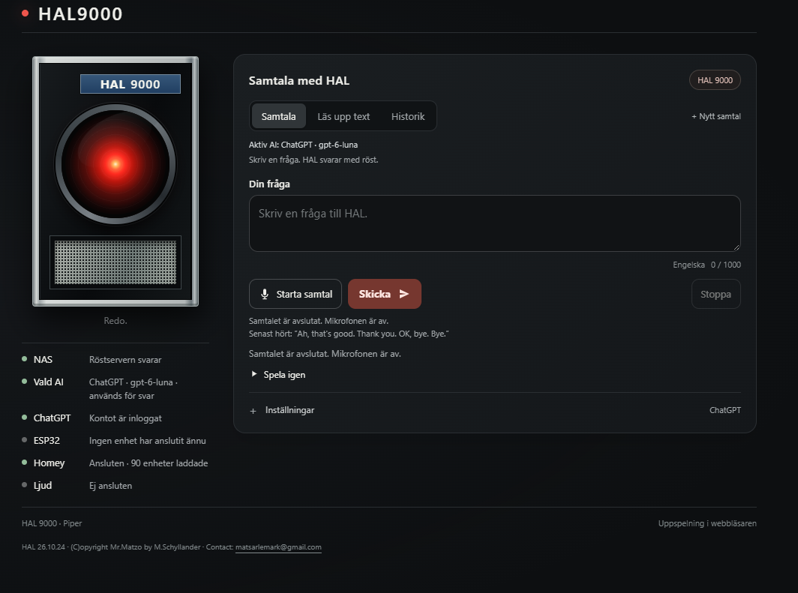
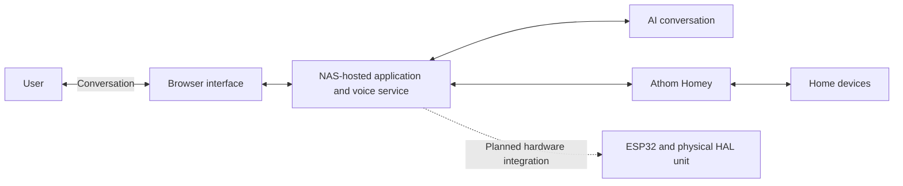

# HAL — Voice Assistant & Home Automation

**Personal project · Work in progress**

A HAL 9000-inspired home assistant combining natural conversation, spoken responses and home automation through **Athom’s Homey** platform.

I am developing HAL as both a useful household assistant and a physical character: a familiar red eye, a calm voice and a slightly unsettling personality inspired by *2001: A Space Odyssey*.

## What I am building

The goal is to talk to HAL naturally: ask an everyday question, request a task or control functions around the house without having to remember a rigid list of commands. The project brings together software, electronics and the practical decisions needed to make those interactions useful.

## Current development status

| Part | Status |
| --- | --- |
| Browser interface | Prototype with conversation, text-to-speech, history and connection status |
| NAS-hosted voice service | Implemented in the software prototype, using Piper for speech synthesis |
| Homey integration | Connected in the current prototype; device selection and natural-language requests are being developed and refined |
| AI conversation | Integrated into the prototype; response behaviour and interaction remain under development |
| ESP32 integration | Planned hardware integration; no ESP32 connected in the screenshot above |
| Physical audio and enclosure | In development; the complete physical assistant is not yet assembled and verified |

The screenshot shows a development snapshot, not a finished product. A connection indicator does not mean that every possible command or device has been tested.

## System direction

The NAS hosts the application and voice services. Homey provides the connection to the smart home. The planned ESP32 integration will connect the software work with the physical build; the detailed hardware arrangement is still being developed.

## Development focus

- Making conversation and spoken responses practical in everyday use.
- Interpreting device and room names, including asking for clarification when a request is ambiguous.
- Developing and testing the connection between conversation and home control.
- Integrating the ESP32, audio hardware and physical enclosure.
- Testing the complete interaction with real hardware.

## Working with AI

I use AI-assisted development tools to understand code, explore alternatives and build prototypes. This gives me more room to focus on the product, ideas and solutions. I define the intended behaviour, assess suggestions, choose the next development steps and test the results.

## About this repository

This initial release documents the project and its current direction. Application and firmware source code will be added as the project is prepared for public release. It is not currently an installable software package.

## Physical build reference

The physical HAL build draws inspiration from [Making HAL 9000 — Golden Armor / Chaucer44](http://chaucer44.squarespace.com/hal9000/making-hal-9000.html). This is an external build reference; its photographs and construction work are not presented as my own.

---

Personal project by **Mats Schyllander** · [Other projects](https://github.com/mschyllander)
