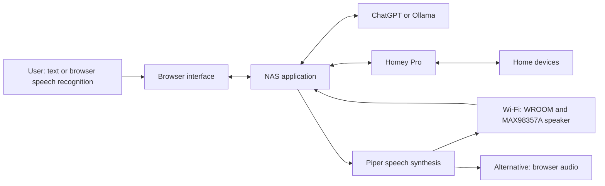

# HAL — Voice Assistant & Home Automation

**Personal project by Mats Schyllander · Hardware and software prototype · Updated October 2026**

HAL combines natural conversation, spoken responses and home automation through
Homey Pro with a physical Wi-Fi speaker. The goal is an assistant that can be
configured once and reconnect automatically when powered on.

The current hardware is an **ESP32-WROOM-32 with a MAX98357A I²S amplifier**.
There is no physical display. The HAL illustration and connection status are
part of the browser interface.

*The image shows an earlier browser-interface snapshot. It is not a photograph
of the physical unit or a record of the latest hardware connection state.*

## Current development status

| Part | Current implementation |
| --- | --- |
| Browser interface | Conversation, text input, browser microphone, voice settings, device setup and connection status. |
| NAS backend | Python application in Docker: AI routing, Piper speech synthesis, Homey control and a bounded audio queue. |
| AI conversation | Selected ChatGPT account connection or Ollama; Ollama currently runs on a separate computer. |
| Home automation | Homey Pro HTTPS API for device discovery and validated commands. |
| Physical audio | ESP32-WROOM-32 retrieves queued WAV audio over Wi-Fi and plays it through a MAX98357A amplifier. |
| Network setup | One-time USB provisioning from the web interface, with settings stored in NVS and reused after restart. |
| Volume | Browser selection of audio output and volume for the next utterance sent to the ESP32 speaker. |
| Standalone listening | Not implemented on the ESP32. Speech input still uses the browser microphone and speech recognition. |

The WROOM audio path has been tested on hardware. The prototype is still under
development; individual playback tests do not establish long-term reliability
or a finished product.

## System architecture

The NAS handles the application, speech synthesis and audio queue. The ESP32
plays audio and reports its status. Homey Pro controls household devices;
it is not used as the HAL speaker.

## Hardware and remaining work

The active firmware uses Zephyr on ESP32-WROOM-32. The MAX98357A uses GPIO27
for BCLK, GPIO14 for LRC and GPIO22 for DIN, with 5 V power and a shared ground.
The previous ESP32-C3/display prototype and Homey speaker experiment have
been retired.

The physical unit still needs microphone input, speech recognition integration,
a wake-word solution and a way to stop playback. The browser currently listens
and speaks in turn. Browser wake-phrase and speaker-interruption experiments
are not standalone ESP32 features.

Further work includes general setup for other networks, recovery testing and
long-running trials. Normal home-network reconnection does not require a
Windows hotspot; the hotspot path is a development aid.

## About this repository

This public repository presents the project and its progress. Application and
firmware source code are not published here. It is not an installable package
or a commercially released product.

I use AI-assisted development tools to explore solutions, understand code and
build prototypes. I define the intended behaviour, choose the development
steps and assess the results through software and hardware testing.

## Physical build reference

The enclosure concept draws inspiration from
[Making HAL 9000 — Golden Armor / Chaucer44](http://chaucer44.squarespace.com/hal9000/making-hal-9000.html).
This is an external reference; its photographs and construction work are not
presented as my own.

---

Personal project by **Mats Schyllander** · [Other projects](https://github.com/mschyllander)
